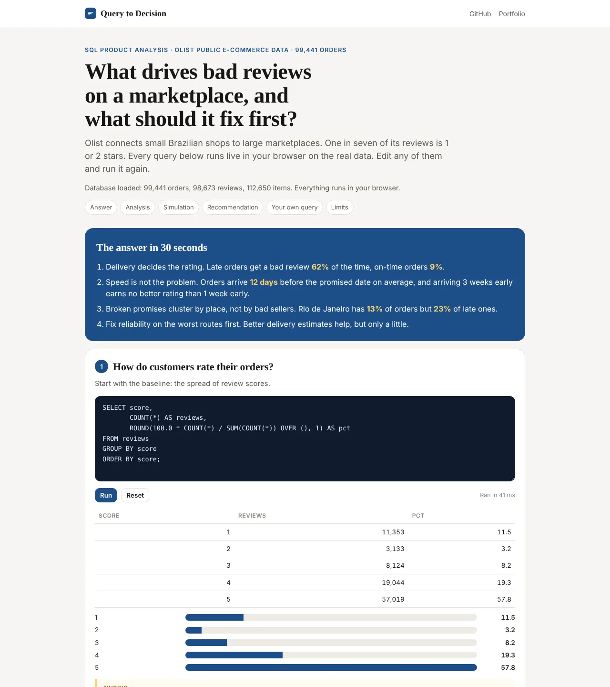

# Query to Decision

**What drives bad reviews on a marketplace, and what should it fix first? A SQL analysis of Olist's public e-commerce data that runs live in the browser, ending in a ranked recommendation.**

**Current version:** 0.1.0

Live: https://kostasxeras.com/query-to-decision/



## The question

Olist connects small Brazilian shops to large online marketplaces. About one review in seven is 1 or 2 stars. A product team with limited capacity needs to know which problem, fixed first, removes the most bad experiences.

## Who it is for

- Marketplace and e-commerce product managers
- Operations and logistics leads deciding where to invest
- Hiring managers reading this as an example of how I go from a question to a decision with SQL

## What is inside

- **10 SQL steps** from baseline to recommendation, each editable and runnable in the browser on the real data, with a result table, a chart and the finding.
- **A simulation** of route-based delivery promises, fitted on 2016 to 2017 orders and tested on 2018 orders.
- **A ranked recommendation** with what to measure and the guardrail for each action, and the size of the prize as an upper bound.
- **A scratchpad** with the schema, for any other question.
- **Reproducible:** the page and the Python checks run the same SQL from one file, and give the same numbers.

## Main findings

Full detail in the [case study](docs/case-study.md).

- **Delivery decides the rating** (confirmed). Late orders get a bad review 62.4% of the time, on-time orders 9.3%. Late and undelivered orders are 9.4% of reviewed orders but 42.8% of bad reviews.
- **Speed is not the problem** (confirmed). Promises average 24.4 days, deliveries 12.5. Arriving 3 or more weeks early scores 4.29, no better than 1 to 2 weeks early (4.30).
- **Broken promises cluster by place, not by bad sellers** (confirmed). Rio de Janeiro has 12.8% of delivered orders and 22.9% of late ones. The 5% of sellers with most late orders handle 49.9% of orders and 58.7% of late orders, so lateness mostly follows volume.
- **Better estimates help only a little** (confirmed). On 2018 orders, a route-based promise of about the same length (23.2 against 23.4 days) is late 7.3% of the time against 7.7%. Cutting today's promises by 2 days raises lateness to 11.3%.
- **Multi-seller orders are a small, sharp problem** (confirmed). 1.3% of orders, 47.4% bad reviews against 13.7% for single-seller orders.
- **Size of the prize** (estimate). If late orders were rated like on-time ones, bad reviews would fall from 14,486 to about 11,095 (−23%) and the average from 4.09 to 4.22. An upper bound that assumes lateness causes the bad rating.
- **Shorter, accurate promises may raise conversion** (hypothesis). The data has no checkout events, so this needs an A/B test.

## Data and sources

[Olist public e-commerce dataset](https://github.com/olist/work-at-olist-data), MIT licence, 99,441 orders from 2016 to 2018. `scripts/build_db.py` turns the CSVs into a small SQLite file: long hash IDs become short numbers, dates are kept to the day, and review text and payments are left out. No rows are removed. SQL in the browser: [sql.js](https://github.com/sql-js/sql.js) 1.17.0, MIT licence, in `vendor/`. Olist is not involved in this project.

## Decisions

- [Run the real SQL in the browser, not screenshots of results](docs/decisions/0001-sql-in-the-browser.md)
- [Test the promise rule on later orders than it was built on](docs/decisions/0002-fit-on-past-test-on-future.md)
- [Recommend route reliability first, estimates third](docs/decisions/0003-reliability-over-estimates.md)

## How I would measure success

The analysis uses past data. These are the measures for the actions it recommends.

| Measure | Definition | Target |
|---|---|---|
| Late rate on Rio routes | Delivered after the promised day, Rio de Janeiro customers | 12.1% today, target 6.8% |
| Bad reviews on failed deliveries | 1 and 2 star share on late and undelivered orders | 62% and 78% today, target [x] |
| Promise length | Average promised days (guardrail) | Not above 24.4 |

## What I would do next

1. Bring back review text and classify the 57% of bad reviews on on-time orders
2. Add carrier data to separate route problems from seller dispatch delays
3. Design the A/B test for shorter, accurate promises at checkout

## How it was built

I framed the problem, made the product calls and wrote the conclusions. Claude (Anthropic) was my engineering partner for the code. 

## Run it yourself

Open `index.html` through any local web server (it fetches the database, so opening the file directly will not work). Rebuild the data: put the Olist CSVs in `work/`, then `python3 scripts/build_db.py`, `python3 scripts/run_queries.py` and `python3 scripts/simulate_promises.py`.

## Repo layout

```
index.html                   The analysis page
data/olist.db.gz             SQLite database (compressed)
data/queries.json            The 10 queries, used by the page and the scripts
data/simulation.json         Promise simulation results
scripts/build_db.py          CSVs to SQLite
scripts/run_queries.py       Runs every query, writes results
scripts/simulate_promises.py Route-based promise simulation
vendor/                      sql.js (MIT)
docs/                        Case study, brief, decisions, outputs, screenshots
```
